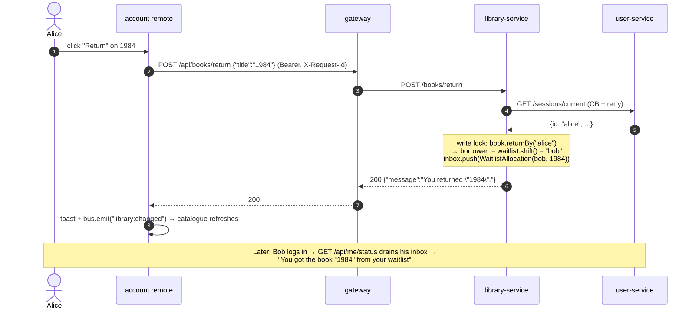
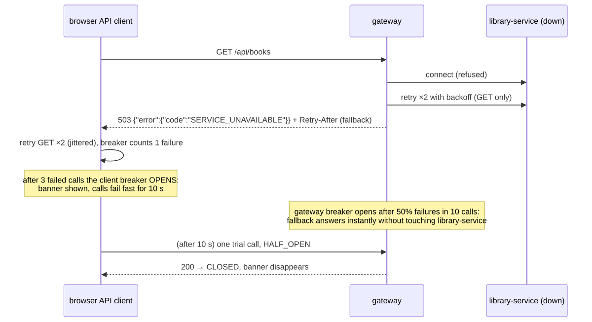
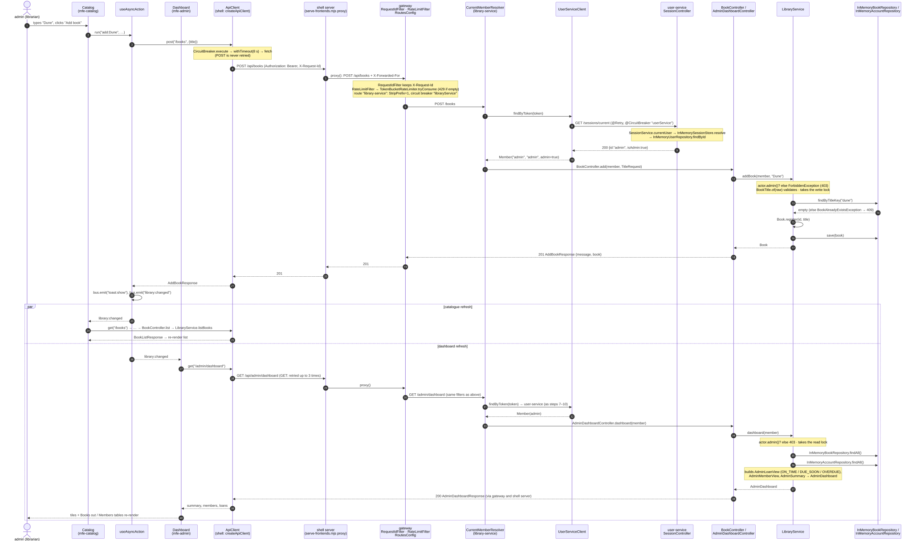
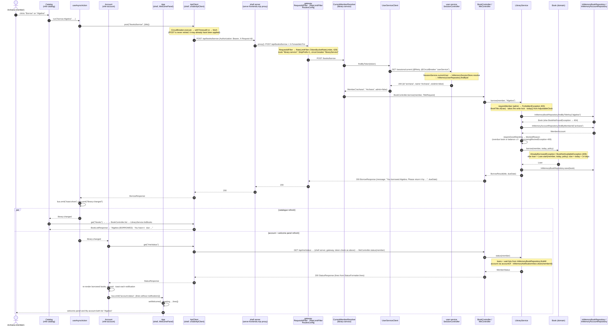

# Library Management — Design Document

| | |
|---|---|
| **Status** | Implemented (v1.0.0) |
| **Scope** | Users borrow, return and wait-list books; an admin manages the catalogue |
| **Stack** | Java 21 · Spring Boot 3.5 · Spring Cloud Gateway 2025.0 · Resilience4j · React 19 · TypeScript · esbuild |

---

## 1. Goals and constraints

**Functional** (from the brief): `login`, `add` (admin only), `list`, `borrow`, `return`, `waitlist`, `status`, `logout`.

**Lending rules (added on request):** every loan has a **due date** (14 days); a member can **move the return date twice, by 7 days each**; overdue books cost a **Rs. 10/day late fee**, deducted from the member's **cash deposit** (Rs. 500, taken at registration) and **block borrowing** until returned; members can top up the deposit. The admin is a **librarian-only** account.

**Constraints that shaped the design**

| Constraint | Consequence |
|---|---|
| `./start.sh` must launch everything with no extra setup | One orchestrator script builds and starts the 3 services and 3 frontends; Maven is bootstrapped if missing |
| Each run is a clean start | All state is in memory; no files or databases; sessions become invalid on restart and the UI handles that gracefully |
| No binaries in the submission | No Maven Wrapper jar (replaced by `scripts/ensure-maven.sh`), no committed builds |
| Spring microservices + React micro-frontends (requested) | Architecture below; complexity is deliberately kept to what each pattern needs to be demonstrated properly |
| NFRs: circuit breaker "and others" | Resilience is applied at three layers: browser → gateway → service-to-service |

---

## 2. Architecture options considered

### 2.1 Backend

| Option | Pros | Cons | Verdict |
|---|---|---|---|
| **A. Modular monolith** (one Spring Boot app, hexagonal modules) | Simplest to run, single transaction boundary, fastest start | No network boundaries, so circuit breakers have nothing real to protect | Best fit for the brief's size; not chosen because microservices were required |
| **B. Gateway + 2 services** (user-service, library-service) | Real inter-service calls (meaningful circuit breakers), each service owns its data, books/loans/wait lists keep one consistency boundary | 3 JVMs; token introspection adds a hop | **Chosen** |
| C. Gateway + 3–4 services (catalog, loans, waitlist, notification) | "More micro" | Borrow/return/wait-list must change *book availability* and *queue* atomically. Splitting them needs sagas or distributed locks for no business gain | Rejected: splits one consistency boundary across services |
| D. Full Spring Cloud (Eureka + Config Server + above) | Enterprise-looking | 5–6 JVMs, 1–2 min start-up, adds infrastructure without adding behaviour | Rejected for a local demo; listed as future work |

**Why books, loans, wait lists and deposits live together.** The core invariant is *"a book that is not borrowed has an empty wait list; on return it goes to the head of the queue."* That is a single aggregate (`Book`). Splitting it would turn every `return` into a distributed transaction. The same goes for late fees: a `return` ends the loan *and* charges the deposit, so the deposit account (`MemberAccount`) sits in the same service. Identity (who you are, your session) has no such coupling, so it is a clean, separate bounded context.

### 2.2 Frontend (micro-frontends)

| Option | Pros | Cons | Verdict |
|---|---|---|---|
| Build-time composition (npm packages) | Simple | Not independently deployable; a release of one team ships everyone | Rejected |
| iframes | Strong isolation | Poor UX (scrolling, focus, styling), awkward communication | Rejected |
| Webpack/Rspack **Module Federation** | Industry default, shared-dependency negotiation | Ties every app to one bundler and its runtime; more build configuration | Good alternative (see ADR-3) |
| **Runtime composition with native ES modules + import map** | Web standards only; any bundler; remotes loaded by URL at runtime; one shared React via the import map | Shared deps must be agreed (pinned) explicitly | **Chosen** |

---

## 3. Chosen architecture



<sub>Mermaid source: [`diagrams/architecture.mmd`](diagrams/architecture.mmd)</sub>

### 3.1 Request path

1. The browser loads the **shell** from `:3000`. Its import map points `react`, `react/jsx-runtime` and `react-dom/client` to one vendor bundle served by the shell.
2. The shell fetches `/mfe-manifest.json` (generated at runtime) and `import()`s each remote from **its own origin**. Remotes are built with React as an *external*, so they share the shell's React instance.
3. Each remote exposes `mount(container, props)` / `unmount(container)` and renders into its own React root. The shell injects `user`, the resilient `api` client and the `bus` (dependency injection across micro-frontends).
4. API calls go to `/api/*` on the shell origin (same-origin, no CORS). The shell server proxies them to the **gateway**, adding `X-Forwarded-For`.
5. The gateway assigns or propagates `X-Request-Id`, rate-limits, routes, and wraps each route in a **circuit breaker with a time limiter and a JSON fallback**.
6. **library-service** authenticates every request by asking **user-service** who owns the bearer token (token introspection), protected by its own Resilience4j circuit breaker, retry and timeouts.

### 3.2 Service responsibilities

| Service | Owns | API (behind `/api` on the gateway) |
|---|---|---|
| **user-service** | Users, sessions (opaque 256-bit tokens, 30 min idle timeout) | `POST /sessions` · `GET /sessions/current` · `DELETE /sessions/current` |
| **library-service** | Books (one copy per title), loans with due dates, FIFO wait lists, deposit accounts and late fees, notifications, the admin dashboard (read model) | `GET /books` · `POST /books` · `POST /books/borrow` · `POST /books/return` · `POST /books/extend` · `POST /books/waitlist` · `GET /me` · `GET /me/status` · `POST /me/deposit` · admin only: `GET /admin/dashboard` · demo only: `GET /admin/clock`, `POST /admin/clock/advance` |
| **gateway** | Edge concerns only (no business logic) | Routes above; `/fallback/{service}`; `/actuator/*` |

Book commands are **task-based and addressed by title** (`{"title": "1984"}`), mirroring `borrow "1984"` on the CLI. That keeps the "not registered" error reachable and matches the brief exactly.

---

## 4. Internal architecture of each service: hexagonal (ports & adapters)

```
com.library.books
├── domain/                 ← pure Java, no Spring: Book (aggregate), BookTitle, Member, errors
├── application/            ← use cases (LibraryService) + read models
│   └── port/               ← driven ports: BookRepository, NotificationInbox, MemberDirectory
├── adapter/
│   ├── in/web/             ← REST controllers, DTOs, exception mapping, @CurrentMember resolver
│   └── out/
│       ├── memory/         ← in-memory repositories (clean start)
│       └── userservice/    ← RestClient + Resilience4j adapter for MemberDirectory
└── config/                 ← composition root: the only place that wires adapters to ports
```

* The **domain and application layers have no framework imports**. They are unit-tested without Spring, and were also compiled and run stand-alone during development.
* Swapping persistence (for example to PostgreSQL) means writing one new adapter per port. Use cases do not change.
* `service-commons` is a small **chassis** library, not a domain library: the error envelope and the correlation-id filter, wired through Spring Boot auto-configuration.

---

## 5. Class diagrams

### 5.1 library-service



<sub>Mermaid source: [`diagrams/class-library-service.mmd`](diagrams/class-library-service.mmd)</sub>

### 5.2 user-service



<sub>Mermaid source: [`diagrams/class-user-service.mmd`](diagrams/class-user-service.mmd)</sub>

### 5.3 gateway



<sub>Mermaid source: [`diagrams/class-gateway.mmd`](diagrams/class-gateway.mmd)</sub>

### 5.4 Frontend: shell and micro-frontend contract



<sub>Mermaid source: [`diagrams/class-frontend.mmd`](diagrams/class-frontend.mmd)</sub>

---

## 6. Design patterns

The system uses patterns at three levels: **architecture** (how the system is split), **resilience** (how it survives failures) and **code** (GoF and DDD patterns inside each component). Each pattern below names the class that implements it.

### 6.1 Architectural patterns

| Pattern | Where | Why |
|---|---|---|
| **Microservices** (database-per-service) | `user-service`, `library-service` | Each service owns its data and can be deployed and scaled on its own |
| **API Gateway** | `gateway` (`RoutesConfig`) | Single entry point; cross-cutting edge concerns (routing, breakers, rate limit, request id) live in one place |
| **Hexagonal / Ports & Adapters** | every service: `domain` → `application` (+ `port`) → `adapter/in`, `adapter/out` | Business rules have no framework code; storage and HTTP are swappable |
| **Layered (inside the hexagon)** | domain → application → adapters | Dependencies point inwards only |
| **Micro-frontends** (runtime composition) | `shell` + `mfe-catalog` + `mfe-account` (members only) + `mfe-admin` (admin only, library dashboard) | Independently built and served UI modules; the manifest's `memberOnly` / `adminOnly` flags decide who gets which remote |
| **Backend-for-Frontend edge / reverse proxy** | shell server `/api` proxy (`serve-frontends.mjs`) | Same-origin API calls, no CORS, one place to add `X-Forwarded-For` |
| **Token introspection** | `UserServiceClient` → `GET /sessions/current` | Services trust user-service for identity; logout is immediate |
| **Task-based API (command style)** | `POST /books/borrow`, `/return`, `/waitlist` | One endpoint per business command, exactly like the CLI commands |

### 6.2 Resilience patterns

| Pattern | Where |
|---|---|
| **Circuit Breaker** | Browser: `CircuitBreaker` (`packages/resilience`); gateway: Resilience4j per route; service-to-service: `@CircuitBreaker` on `UserServiceClient` |
| **Retry with exponential backoff + jitter** | `retry()` (GET only), gateway `retry` filter (GET only), `@Retry` on `UserServiceClient` |
| **Timeout** | `withTimeout()`, gateway `TimeLimiter`, `RestClient` connect/read timeouts |
| **Fallback** | `FallbackController` (gateway), `RemoteSlot` error + Retry (UI) |
| **Rate Limiter (token bucket)** | `TokenBucketRateLimiter` + `RateLimitFilter` |
| **Bulkhead (fault isolation)** | each micro-frontend in its own React root with its own `ErrorBoundary`; one breaker per downstream at the gateway |
| **Health check / readiness probe** | Actuator `health/readiness`, used by `start-all.mjs` before routing traffic |
| **Correlation ID** | `RequestIdFilter` (gateway + `service-commons`), MDC logging |
| **Graceful shutdown** | `server.shutdown: graceful` + SIGTERM handling in the orchestrator |

### 6.3 Domain-Driven Design (tactical) patterns

| Pattern | Class | Note |
|---|---|---|
| **Aggregate root** | `Book` | Owns borrower + wait list; enforces "an available book has no queue" |
| **Value Object** | `BookTitle`, `UserName` | Immutable, self-validating, equality by normalised key |
| **Entity** | `User`, `Member` | Identity = lower-cased name |
| **Domain event** | `WaitlistAllocation` | Raised when a returned book is handed to the next member |
| **Repository** | `BookRepository`, `AccountRepository`, `UserRepository` (+ in-memory implementations) | Collection-like access to aggregates |
| **Application service** | `LibraryService`, `SessionService` | One method per use case; no business rules of its own |
| **Bounded context** | identity (user-service) vs lending (library-service) | Split where there is no shared invariant |

### 6.4 GoF and other code-level patterns

| Pattern | Where | What it does here |
|---|---|---|
| **Adapter** | `InMemoryBookRepository`, `UserServiceClient`, controllers | Translate between ports and technology (HashMap, HTTP, JSON) |
| **Proxy** | Spring AOP proxy around `UserServiceClient` (Resilience4j annotations); shell `/api` proxy | Add retry/breaker behaviour without changing the class |
| **Decorator** | API client layering `breaker → retry → timeout → fetch` (`createApiClient`) | Each layer wraps the next with one extra responsibility |
| **State** | `CircuitBreaker` (`CLOSED` / `OPEN` / `HALF_OPEN`) | Behaviour of `execute()` depends on the current state |
| **Strategy** | `isFailure` classifier in `CircuitBreaker`, `shouldRetry` in `retry()`, `IdGenerator`/`Clock` injected into services | Pluggable policy without changing the algorithm |
| **Observer / Publish-Subscribe** | `EventBus` (`library:changed`, `toast:show`, `account:status`, `session:ended`) | Micro-frontends react to each other without direct imports; `account:status` lets the shell's welcome panel mirror the account remote's latest status |
| **Chain of Responsibility** | Gateway `GlobalFilter`s (`RequestIdFilter` → `RateLimitFilter` → route filters); servlet `RequestIdFilter` | Each filter handles or passes the request on |
| **Static Factory Method** | `Book.register/restore`, `BookTitle.of`, `UserName.of`, `User.register`, `ApiError.of`, `createApiClient`, `createRemoteLoader`, `createEventBus` | Named constructors that validate before creating |
| **Memento / Snapshot** | `Book.snapshot()` / `Book.restore()` | Repositories store immutable snapshots, so state changes only via `save` |
| **Template Method** | `RequestIdFilter extends OncePerRequestFilter`; `ErrorBoundary extends Component` | Framework defines the skeleton, we fill one step |
| **Dependency Injection + Composition Root** | `LibraryServiceConfig`, `UserServiceConfig`; shell injects `{user, api, bus}` into remotes via `mount()` | Only one place knows concrete classes |
| **Plugin / contract** | `MicroFrontend` interface (`contractVersion`, `mount`, `unmount`) | Shell loads any module that meets the contract |
| **Singleton (scoped)** | Spring beans; one shared React instance via the import map; one API client per shell | One instance per application context |
| **Readers-Writer Lock** | `LibraryService` (`ReentrantReadWriteLock`) | Concurrent reads, exclusive check-then-act writes |
| **Page Object** (test pattern) | `e2e/pages/library-app.ts` | Playwright tests talk to the UI through one class |
| **Test Data Builder / Fixture base class** | `RestAssuredSupport` | Shared REST Assured setup and helpers |

### 6.5 Lending rules (domain model)

| Rule | Where it is enforced |
|---|---|
| A loan is due **14 days** after borrowing (or after a wait-list hand-over) | `Loan.start` |
| The return date can be moved **at most 2 times, by 7 days each**, also while others are waiting; **not** once the loan is overdue (returning on the due date is still on time) | `Book.extend` → `ExtensionNotAllowedException` |
| Late fee = **Rs. 10 × days late**, charged to the deposit on return; the balance may go negative | `Loan.lateFee`, `MemberAccount.chargeLateFee` |
| A member with **any overdue book** or a **balance ≤ 0** cannot borrow or join a wait list (they can still return, extend and top up) | `LibraryService.blockedReason` → `BorrowingBlockedException` |
| **Rs. 500 cash deposit** recorded at registration (the member's first contact with the library), shown as "Rs. 500 received as deposit in cash." | `LibraryService.accountOf` → `MemberAccount.open` |
| Top-ups of **Rs. 100 – 100,000** | `LibraryService.deposit` |
| The **admin** (librarian) has no deposit and cannot borrow/return/extend/queue; sees every loan's borrower, due date and overdue days | `LibraryService.requireMember`, `toView` |
| The **admin dashboard** counts registered members, books out, wait-list requests and deposits held, and flags each loan as **overdue** or **due soon** (due within 3 days, today included); a member with an overdue book or a balance ≤ 0 is shown as blocked | `LibraryService.dashboard` (`DUE_SOON_DAYS`), `AdminDashboardController` |
| All amounts are whole rupees (`Money`); all dates are calendar days in **Asia/Kolkata** (`library.time-zone`) | `Money`, `AdjustableClock` |

All values are configurable in `library-service/src/main/resources/application.yml` (`library.lending.*`).

**Demo clock.** Nobody can wait 14 days in a demo, so the library reads time from an `AdjustableClock` (real time + an offset that only moves forward). The admin UI shows *Library date* with **+1 / +7 / +15 days** buttons (`POST /admin/clock/advance`). It is enabled by default for this assignment and switched off with `LIBRARY_DEMO_TIME_TRAVEL=false`, in which case the endpoints do not exist and the controls disappear.

---

## 7. Key flows

### 7.1 Return with wait-list hand-over (Alice returns "1984"; Bob is first in line)



<sub>Mermaid source: [`diagrams/sequence-return-waitlist.mmd`](diagrams/sequence-return-waitlist.mmd)</sub>

### 7.2 Failure handling (library-service down)



<sub>Mermaid source: [`diagrams/sequence-failure-handling.mmd`](diagrams/sequence-failure-handling.mmd)</sub>

### 7.3 Admin flow: add a book, then the catalogue and the dashboard refresh

From the browser to the service: shell API client, shell server, gateway filters, token check with user-service, then `BookController` → `LibraryService` → repository. The `library:changed` event then makes the catalogue and the librarian dashboard (`AdminDashboardController` → `LibraryService.dashboard`) reload.



<sub>Mermaid source: [`diagrams/sequence-admin-add-book.mmd`](diagrams/sequence-admin-add-book.mmd)</sub>

### 7.4 Member flow: borrow a book, then the catalogue, account and welcome panel refresh

The same path, plus the domain rules on the way (`requireGoodStanding`, `Book.borrow` → `Loan.start`). Afterwards the account remote reloads `GET /me/status` and shares its lines with the shell (`account:status`), which updates the welcome panel.



<sub>Mermaid source: [`diagrams/sequence-member-borrow.mmd`](diagrams/sequence-member-borrow.mmd)</sub>

---

## 8. Non-functional requirements

### 8.1 Resilience

| Concern | Where | How |
|---|---|---|
| **Circuit breaker** (client) | `frontend/packages/resilience` used by the shell's API client | 3 consecutive infrastructure failures open it for 10 s; half-open admits one trial call. **Business errors (4xx) and 429 never trip it.** State is shown in a banner. |
| **Circuit breaker** (edge) | Gateway, one per downstream (`userService`, `libraryService`) | Resilience4j via Spring Cloud CircuitBreaker; 50% failure rate over 10 calls; 5xx responses count as failures; JSON **fallback** 503 + `Retry-After`. |
| **Circuit breaker** (service-to-service) | library-service → user-service (`UserServiceClient`) | `@CircuitBreaker` + `@Retry`; 401 is a valid answer, not a failure; open circuit → 503 to the caller. The breaker's health indicator does not fail library-service's own health check. |
| **Timeouts** | Everywhere | Browser 8 s (AbortController); gateway time limiter 4 s, connect 1 s, response 5 s; RestClient connect 1 s / read 2 s; shell proxy 10 s. |
| **Retries** | Browser, gateway, library-service | **GET only** (idempotent), exponential backoff with jitter. POSTs are never retried: a "borrow" that timed out may already have happened. |
| **Fallbacks** | Gateway, shell | Gateway returns a well-formed 503 instead of hanging; the shell shows a per-slot error with *Retry* if a remote fails to load. |
| **Fault isolation (UI)** | `RemoteSlot` + per-remote `ErrorBoundary` | Each remote has its own React root; a missing, incompatible (contract version) or crashing remote affects only its slot. Remote loading has a 5 s timeout. |
| **Graceful shutdown** | All services | `server.shutdown=graceful`; the orchestrator sends SIGTERM and waits up to 15 s. |

### 8.2 Security

* **Authentication**: opaque random 256-bit bearer tokens (`SecureRandom`), idle expiry, server-side revocation on logout. Tokens are kept in `sessionStorage` (per tab), not `localStorage`.
* **Authorisation**: `add` is admin-only and `borrow`/`return`/`waitlist` are member-only. Both are checked in the application layer (`ForbiddenException` → 403), not only hidden in the UI.
* **Input validation** in value objects: trimmed, whitespace-collapsed, NFC-normalised, length-limited (name 50, title 200), control characters rejected.
* **Request limits**: gateway rejects bodies over 16 KB; per-client token-bucket rate limit (60 burst, 20/s) → 429 + `Retry-After`.
* **No information leakage**: unknown errors are logged with stack trace server-side and returned as a generic 500 with a `requestId` for support.
* **Browser hardening**: strict **Content-Security-Policy** on the shell (only the import map by hash, scripts only from the remotes' origins), `X-Content-Type-Options: nosniff`, `Referrer-Policy: no-referrer`, `frame-ancestors 'none'`; remotes send CORS only for the shell origin; static servers block path traversal. React escapes all rendered text.
* **Log injection**: incoming `X-Request-Id` values are accepted only when they match `[A-Za-z0-9._-]{1,64}`.
* *Out of scope (documented):* passwords/OAuth2 (the brief has none), TLS (local), and trusting `X-Forwarded-For` only from known proxies.

### 8.3 Consistency and concurrency

* Tomcat serves requests on many threads. `LibraryService` guards every read-modify-write with a **fair `ReentrantReadWriteLock`**. A test fires 32 concurrent borrows of the same book and expects exactly one success.
* User creation uses an atomic `putIfAbsent`, so concurrent first logins of the same name produce one user.
* Repositories store **immutable snapshots** and rehydrate on read, so state changes only through `save`, as with a database.
* With a database adapter, the lock becomes a transaction plus optimistic locking (a `version` column on `Book`).

### 8.4 Observability

* **Correlation id** `X-Request-Id`: created or validated at the edge (browser or gateway), propagated gateway → services → user-service, put in the logging MDC (`[%X{requestId}]`), echoed in responses and in every error body.
* **Access log** per request at the gateway (method, path, status, latency).
* **Actuator**: `health` (liveness/readiness probes), `metrics`, `circuitbreakers` (library-service, gateway), `gateway` routes.

### 8.5 Performance and scalability

* Stateless services apart from in-memory storage. Horizontal scaling needs shared storage (DB) for library-service, a shared session store (Redis) or JWTs for user-service, and a distributed rate limiter (Redis `RequestRateLimiter`) at the gateway.
* JVMs run with modest flags (`-XX:TieredStopAtLevel=1 -Xmx256m`) for a quick local start; override with `JAVA_OPTS`.
* Frontends are minified and React is downloaded once and shared by all remotes.

### 8.6 Clean start

Every run starts with no users, books or sessions (all in memory), and recreates `logs/`. Browser sessions from a previous run are detected (401 on the start-up check) and the user is returned to the login page with a message.

---

## 9. Decisions on ambiguities and assumptions

| # | Topic | Decision | Reasoning |
|---|---|---|---|
| 1 | Interface | Browser UI (React micro-frontends), allowed by the brief | Requested architecture |
| 2 | Identity | `login [name]` needs no password; unknown names are registered | As the brief specifies |
| 3 | Name matching | **Case-insensitive** (`Alice` = `alice`); first spelling is kept for display; `Admin`/`ADMIN` are the admin | Avoids duplicate accounts and ambiguous admin rights |
| 4 | Title matching | Case-insensitive, whitespace-normalised (`the  great GATSBY` finds *The Great Gatsby*) | Friendlier, same result for the same intent |
| 5 | Copies | One copy per title; adding an existing title is rejected (409) | The brief models availability per title |
| 6 | Return with a wait list | The book goes **directly** to the first person in the queue and stays *borrowed*; the others move up | Matches the example (`1984 (borrowed)` after Alice's return; Bob gets it; Carol becomes position 1) |
| 7 | Notification | Shown once, at the next login (or next status refresh if already logged in) | Matches "You got the book … from your waitlist" in the example |
| 8 | Greeting on login | Always "Hello, <name>!", followed by the notification and status lines | The example omits "Hello" in one place, which reads as a typo |
| 9 | Wait list for an available book | Rejected with a hint to borrow it | Otherwise the queue would hold a book nobody has |
| 10 | Wait list for your own book / twice | Rejected (409) with your current position | Idempotency and clear feedback |
| 11 | Borrowing your own book again | Rejected: "You have already borrowed …" | Distinct from "not available" |
| 12 | Admin borrowing | **Not allowed**: admin is a librarian account (add + list only); borrow/return/wait list answer 403. The UI hides lending controls and the *My account* panel for admin, shows how many members wait for each book, and the admin greeting matches the brief (no status lines) | Clear separation of duties; the rule is enforced in `LibraryService`, not only hidden in the UI |
| 13 | Due dates and extensions | 14-day loans, 2 extensions of 7 days, allowed even with a wait list, not when overdue | Agreed with the stakeholder; extending an overdue loan would let a member dodge late fees |
| 14 | Not returning a book | Rs. 10/day late fee from the deposit on return; borrowing and wait-listing blocked while overdue or while the balance is ≤ 0 | Agreed with the stakeholder |
| 15 | Registration / credentials | No password; first contact records a Rs. 500 cash deposit with the message "Rs. 500 received as deposit in cash." | Agreed with the stakeholder ("no password for now") |
| 16 | Wait-list hand-over to a blocked member | The book is still handed over (with a fresh 14-day loan) | They queued while in good standing; skipping them would be surprising. Could be changed to "skip blocked members" |
| 17 | `status` output | The brief's lines, extended with "- due DD MMM YYYY", overdue warnings and "Your deposit balance: Rs. N" | Needed to show the new rules; the brief allows extra output |
| 18 | Borrow limit, leaving a wait list, lost books | Not implemented | Not requested; noted as future work |
| 19 | `list` order | Registration order | Matches the example numbering |
| 20 | Logout without login | Not possible in the UI; the API answers 401 | — |
| 21 | Service unavailable | 503 with a friendly message, never a hang | NFR |
| 22 | Commands by title | The UI has per-row buttons and an "act by title" form | The form keeps the brief's error cases reachable (`borrow "1985"`) |

---

## 10. Testing strategy

| Level | Tool | What |
|---|---|---|
| Domain unit | JUnit 5 + AssertJ | `Book` rules (borrow/return/queue), value objects, `TokenBucketRateLimiter`, session expiry |
| Application | JUnit 5 | Use cases incl. the full example, notification once-only, **concurrency** (32 threads), admin dashboard (admin only; counts, overdue / due-soon flags, blocked members) |
| REST (black box) | **REST Assured** on a random port | user-service session API; library-service *example session replayed over HTTP*, error mapping (400/401/403/404/409/415/503); gateway routing, request-id propagation, **fallback on 5xx and on unreachable service**, **rate limiting 429** |
| Resilience integration | Spring Boot test + JDK HTTP server as fake user-service | Retry count, 401 is not a failure, breaker opens and then **fails fast without calling** |
| Frontend unit | `node:test` + tsx | Circuit breaker states, retry/backoff, timeout, API client (no POST retries, breaker on 5xx only, 401 hook), remote loader (contract/version/timeout/retry), event bus isolation |
| End-to-end UI | **Playwright** | The **example session through the browser**, login validation, case-insensitive names, reload persistence, stale session after restart, admin duplicate handling, cross-remote sync, **remote failure isolation + retry**, **client circuit breaker banner and recovery**, **admin dashboard** (hidden from members, loans and members listed, overdue loan flagged with its fee) |

---

## 11. Architecture Decision Records (summary)

* **ADR-1 Gateway + 2 services.** Split at the identity boundary only; keep the `Book` aggregate whole (§2.1).
* **ADR-2 Hexagonal services.** Framework-free core, adapters at the edges; enables in-memory storage now and a DB later without touching use cases.
* **ADR-3 ESM + import maps instead of Module Federation.** Standards-based, bundler-agnostic, simple to reason about. Trade-off: shared dependency versions are pinned centrally in the shell rather than negotiated at runtime. Migrating to Module Federation would change only the build and loader, not the `mount/unmount` contract.
* **ADR-4 Shell owns cross-cutting concerns.** One API client (and therefore one circuit breaker and one session) injected into remotes, instead of each remote re-implementing HTTP and auth.
* **ADR-5 Token introspection instead of JWT.** Logout is immediate and tokens carry no data. Trade-off: one extra hop per request, protected by a breaker. JWTs plus a short revocation list would remove the hop at scale.
* **ADR-6 Retries only for idempotent requests.** Correctness over availability for state-changing commands.
* **ADR-7 Mock gateway for frontend development.** Lets the UI and its Playwright suite run without JVMs. The mock follows the same contract (`packages/contracts`), but **library-service remains the owner of the rules**; REST Assured tests verify those rules on the real service.

---

## 12. Future work

Persistent storage (PostgreSQL + Flyway, optimistic locking) · scheduled overdue reminders (email/SMS) · passwords/OIDC · Redis session store or JWT · Redis-backed distributed rate limiting · service discovery and config server · OpenTelemetry tracing (Micrometer Tracing) · Docker Compose / Kubernetes manifests with readiness probes · OAuth2/OIDC login · multiple copies per title, borrow limits, leaving a wait list, lost-book charges · real-time push (SSE) of wait-list allocations instead of on-next-refresh.
